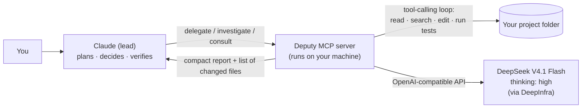

<div align="center">


# Deputy

### Deputize cheap models. Claude stays the sheriff.

**A Claude Code plugin and MCP server that hands bulk coding work, big reads and second opinions to
DeepSeek V4.1 Flash (thinking on), while Claude plans, decides and verifies.**

Cut what you spend on Claude Code tokens without giving up Claude's judgment.

[](https://github.com/alimohammadiamirhossein/deputy/stargazers)
[](https://github.com/alimohammadiamirhossein/deputy/actions/workflows/ci.yml)
[](LICENSE)
[](https://www.python.org/)
[](https://modelcontextprotocol.io/)
[](#-quick-start)

**⭐ If Deputy saves you money or tokens, please [star the repo](https://github.com/alimohammadiamirhossein/deputy/stargazers). It is the best way to help other people find it.**

</div>

---

## Contents

- [What Deputy does](#-what-deputy-does)
- [Why Deputy](#-why-deputy)
- [Quick start](#-quick-start)
- [Step 1: Create your DeepInfra account](#step-1-create-your-deepinfra-account-and-api-key)
- [The recommended model: DeepSeek V4.1 Flash with thinking on](#-the-recommended-model-deepseek-v41-flash-with-thinking-high)
- [Using Deputy](#-using-deputy)
- [How Claude gets the most out of Deputy](#-how-claude-gets-the-most-out-of-deputy)
- [Configuration](#-configuration)
- [Costs](#-what-it-costs)
- [Safety](#-safety)
- [Terms of service and privacy](#-terms-of-service-and-privacy)
- [Deputy vs. other approaches](#-deputy-vs-other-approaches)
- [FAQ](#-faq) · [Troubleshooting](#-troubleshooting) · [Roadmap](#-roadmap)

---

## ✨ What Deputy does

Claude (for example Opus 5.5 in Claude Code) stays the **lead agent**. Deputy gives it three new
tools that run a much cheaper model as a **sub-agent** inside your project:

| Tool | What it is for | Can change files? |
|---|---|---|
| **`delegate`** | Well-specified coding work: multi-file edits, refactors, tests, boilerplate, migrations, lint and type fixes | Yes |
| **`investigate`** | Questions that need a lot of reading: "where is X handled?", "how does auth work?", big log scans | No, read-only |
| **`consult`** | A cheap **second opinion**: ideas, risks and alternatives from several angles in parallel, clearly labelled as unverified | No, read-only |



Deputy runs its **own agent loop**: the cheap model reads files, edits them and runs your tests by
itself. Claude only sees a short report and the list of changed files, so Claude's context (and
your bill) stays small. That is the difference from MCP servers that just forward one chat message:
with those, Claude still has to read every file and paste it in.

## 🎯 Why Deputy

- **💸 Big savings where tokens pile up.** Reading code, iterating on tests and writing boilerplate
  are the expensive parts of an agent session. Deputy moves them to a model that costs a small
  fraction of frontier-model prices.
- **🧠 Claude keeps the judgment.** Claude writes the brief, chooses what to delegate, and verifies
  the result. Architecture, tricky debugging and security stay with Claude.
- **🗣️ Second opinions that make Claude better.** `consult` runs up to four independent
  "lenses" in parallel (for example *simplest approach*, *edge cases*, *performance*). Claude
  weighs the ideas below its own analysis and keeps only what it can verify.
- **🔌 Two-command install** as a Claude Code plugin. Your API key goes into Claude Code's secure
  storage, not a text file.
- **✅ Plays by the rules.** Claude Code stays unmodified and keeps talking to Claude. Deputy is
  an ordinary MCP tool that uses your own DeepInfra key. See [Terms of service](#-terms-of-service-and-privacy).
- **🛡️ Sandboxed to your project.** File access is confined to the project folder, secrets are
  stripped from command environments, and read-only modes really are read-only.
- **🪟 Works on Windows, macOS and Linux.** Tested in CI on all three.
- **🧩 Any OpenAI-compatible model.** DeepSeek V4.1 Flash on DeepInfra is the default, but you can
  point Deputy at any OpenAI-compatible endpoint, including a local model.

## 🚀 Quick start

You need [Claude Code](https://code.claude.com), a [DeepInfra](https://deepinfra.com/) account,
and [uv](https://docs.astral.sh/uv/getting-started/installation/) (it runs Deputy for you).

### Step 1: Create your DeepInfra account and API key

DeepInfra is a US inference provider that hosts DeepSeek's open-weight models. Its standard tier
for DeepSeek V4.1 Flash is cheaper than DeepSeek's own API, and DeepInfra
[states](https://docs.deepinfra.com/account/data-privacy) that it does not train on your data
and does not store your inputs to disk.

1. Go to **[deepinfra.com](https://deepinfra.com/)** and click **Sign up**. You can use GitHub,
   Google or an email address.
2. Open your **Dashboard** and go to **Billing**. Add a card (payments go through Stripe) and
   **add funds**. Start small: **$5–10 is plenty** to see how far it goes.
3. Still in Billing, **set a spending limit** equal to what you added, so you can never be charged
   more than you planned.
4. Go to **API Keys** and click **New API key**. Name it something like `deputy` and copy it.
   DeepInfra keys start with `sk-di-`.
5. Keep the key private. Never paste it into chats, issues or commits. If it leaks, delete it in
   the dashboard and create a new one.

You do **not** need to buy a model, a plan, a dedicated GPU or the "priority" tier. Pay-as-you-go
credit is all Deputy needs.

### Step 2: Install uv

```bash
# macOS / Linux
curl -LsSf https://astral.sh/uv/install.sh | sh
```

```powershell
# Windows (PowerShell)
powershell -ExecutionPolicy ByPass -c "irm https://astral.sh/uv/install.ps1 | iex"
```

### Step 3: Install the Deputy plugin

```bash
claude plugin marketplace add alimohammadiamirhossein/deputy
claude plugin install deputy@deputy
```

Or, inside a Claude Code session: `/plugin marketplace add alimohammadiamirhossein/deputy`,
then `/plugin install deputy@deputy`.

When you enable the plugin, Claude Code asks for your **DeepInfra API key** and stores it in your
system's secure storage. (Prefer an environment variable? Leave the field empty and set
`DEEPINFRA_API_KEY` instead; see [Configuration](#-configuration).)

### Step 4: Restart Claude Code and try it

```text
/deputy:delegate add type hints to every function in src/utils and make the tests pass
/deputy:investigate how does a request flow from the router to the database?
/deputy:consult I plan to cache user sessions in Redis. What am I missing?
```

You can also just talk normally ("have Deputy write the tests for this module"). Claude knows
when to use each tool.

## 🏆 The recommended model: DeepSeek V4.1 Flash with thinking `high`

Deputy's default is **`deepseek-ai/DeepSeek-V4.1-Flash-1017` on DeepInfra's standard tier, with
thinking set to `high`.** It is the best price-to-capability option we found for this job:

| | DeepSeek V4.1 Flash (1017) on DeepInfra |
|---|---|
| Price (standard tier, Oct 2026) | **$0.098** per 1M input tokens · **$0.294** per 1M output tokens |
| Cached input | about 3% of the input price, which matters a lot for agent loops |
| Context window | about 1M tokens |
| Tool calling | Yes, reliable in our end-to-end tests (read → edit → run → verify) |
| Thinking | Yes, **but off unless you ask for it** (see below) |
| Hosting and data | US provider; states no training on your data; no data sent to DeepSeek's servers |

**Why thinking matters, and why Deputy turns it on for you.** On DeepInfra, DeepSeek V4.1 Flash
does **not** think by default. In our tests, a request without a thinking setting produced
**zero** reasoning tokens. Sending `reasoning_effort: "high"` turned thinking on, and the model
then passed our full tool-use test (read a file, edit it, run a shell check, report). Deputy
always sends the thinking level, and it passes the model's reasoning back between tool calls,
which DeepSeek's thinking mode expects. Many other tools forget one or both.

Use `high` for normal work. Claude can pass `thinking: "max"` for hard tasks (slower and more
output tokens). Run `deputy doctor` to confirm thinking is really on with your key.

> Prices change and promotions end. Check [deepinfra.com/pricing](https://deepinfra.com/pricing).

## 🧰 Using Deputy

### Slash commands (from the plugin)

| Command | What happens |
|---|---|
| `/deputy:delegate <task>` | Claude writes a full brief and hands the task to Deputy, then verifies the changes |
| `/deputy:investigate <question>` | Deputy reads the code and returns an answer with `file:line` evidence |
| `/deputy:consult <question or plan>` | Deputy brainstorms from 2–3 angles; Claude decides what to keep |

### MCP tools (what Claude calls)

| Tool | Parameters |
|---|---|
| `delegate` | `task`, `context`, `thinking` (`high` / `max`), `workdir` |
| `investigate` | `question`, `context`, `thinking`, `workdir` |
| `consult` | `question`, `context`, `lenses` (up to 4 angles), `thinking` |
| `status` | none: shows model, thinking level, workspace, key status and session spend |

Every `delegate` result starts with a stats line and the files Deputy changed. This is a real run
("fix the bug in `add`, add tests for `divide`, make pytest pass") on a small demo project:

```text
Deputy code run [deepseek-ai/DeepSeek-V4.1-Flash-1017, thinking high]: completed | 9 turns | 46s | 17,414 in (14,464 cached), 1,068 out (74 thinking) | est. cost $0.0006
Files changed (review these before relying on them):
  M calc/ops.py (+1 -1)
  M test_ops.py (+15 -0)
Commands run (4): `python -m pytest -q` -> 1; ... `python -m pytest -q` -> 0
--- Deputy's report ---
RESULT: done
SUMMARY: `calc/ops.py` had `add` returning `a - b`; I changed it to `return a + b`. I added three
plain-pytest divide tests to `test_ops.py` ...
VERIFY: `python -m pytest -q` -> `4 passed in 0.07s`, exit code 0.
```

And a real `consult` with two lenses, asked "I plan to make `divide` return `None` instead of
raising on zero. Good idea?". Each lens read the code and came back with ideas such as *"keep
`divide` raising and add a separate `safe_divide`"* and *"an `if b == 0` guard breaks NumPy arrays
and turns `TypeError` into `None`"*, each with a confidence level. The whole consult cost $0.0018.

## 🧠 How Claude gets the most out of Deputy

Deputy is built around one idea: **spend frontier-model tokens on judgment, and cheap tokens on
everything else.**

- **Claude is the architect and reviewer.** It decides *what* to build and checks *that it is
  right*. Deputy does the reading, typing and test iterations.
- **Delegate early.** Claude should decide to delegate *before* reading lots of code itself;
  otherwise you pay for the reading twice. The bundled skills teach Claude this.
- **Briefs, not chats.** One complete unit of work with acceptance criteria beats many tiny calls.
- **Compact results.** Deputy returns a short report and a change list, not its whole transcript.
  Claude reads only the files that matter.
- **Diverse second opinions, discounted.** `consult` answers are explicitly marked as coming from
  a weaker model. Claude uses them to *consider more options*, then trusts its own analysis and
  verifies before adopting anything.
- **Verify, always.** Deputy's "done" is a claim. Claude reviews the diff and runs the tests.

## ⚙️ Configuration

Everything is set with environment variables. The plugin sets the first three for you.

| Variable | Default | Meaning |
|---|---|---|
| `DEPUTY_API_KEY` | (from the plugin prompt) | API key. Falls back to `DEEPINFRA_API_KEY`, then `DEEPINFRA_TOKEN` |
| `DEPUTY_THINKING` | `high` | `none`, `low`, `medium`, `high` or `max` |
| `DEPUTY_WORKSPACE` | project folder | Folder Deputy may touch. Deputy refuses your home folder and drive roots |
| `DEPUTY_MODEL` | `deepseek-ai/DeepSeek-V4.1-Flash-1017` | Any model your endpoint serves |
| `DEPUTY_BASE_URL` | `https://api.deepinfra.com/v1/openai` | Any OpenAI-compatible endpoint (https, or http on localhost) |
| `DEPUTY_MAX_TURNS` | `40` | Tool-calling rounds per run |
| `DEPUTY_MAX_RUN_TOKENS` | `2000000` | Token budget per run (input + output, all rounds) |
| `DEPUTY_MAX_OUTPUT_TOKENS` | `16384` | Output limit per model response |
| `DEPUTY_RUN_TIMEOUT` | `1800` | Seconds per run |
| `DEPUTY_COMMAND_TIMEOUT` | `180` | Seconds per shell command |
| `DEPUTY_KEEP_REASONING` | `true` | Pass the model's reasoning back between tool calls |
| `DEPUTY_PRICE_INPUT` / `_CACHED` / `_OUTPUT` | DeepInfra prices | USD per 1M tokens, for cost estimates |

Deputy never uses `OPENAI_API_KEY`, so a real OpenAI key can't be sent to another provider by
accident.

**Set the key as an environment variable instead of the plugin prompt:**

```bash
# macOS / Linux: add to ~/.zshrc or ~/.bashrc
export DEEPINFRA_API_KEY="sk-di-..."
```

```powershell
# Windows: saved for your user account; restart Claude Code afterwards
[Environment]::SetEnvironmentVariable('DEEPINFRA_API_KEY', 'sk-di-...', 'User')
```

### Without the plugin (any MCP client)

```bash
claude mcp add deputy -s user -- uvx --from git+https://github.com/alimohammadiamirhossein/deputy deputy serve
```

For Cursor, Cline, Windsurf or Claude Desktop, add a stdio server with the command
`uvx --from git+https://github.com/alimohammadiamirhossein/deputy deputy serve`.

### Check your setup

```bash
uvx --from git+https://github.com/alimohammadiamirhossein/deputy deputy doctor
```

`doctor` checks your key and the endpoint, and confirms that **thinking is really on**.

## 💰 What it costs

Agent loops resend the conversation every round, so most input tokens are cached and cost about
3% of the normal input price.

**Measured** on a small demo project with the default model (thinking `high`):

| Run | Tokens | Time | Cost |
|---|---|---|---|
| `delegate`: fix a bug, add 3 tests, run pytest until green | 17k in (83% cached), 1k out | 46 s | **$0.0006** |
| `investigate`: list functions and their tests, with evidence | 6k in, 0.9k out | 18 s | **$0.0004** |
| `consult` with 2 lenses in parallel | 6.5k in, 5k out | 68 s | **$0.0018** |
| `deputy doctor` check | tiny | 17 s | $0.00003 |

**Estimated** for real-world projects (bigger files, more rounds):

| Task | Typical tokens | Rough cost |
|---|---|---|
| `consult` with 2–3 lenses | 20k–60k | under $0.01 |
| `investigate` a medium codebase | 100k–400k | $0.002–0.02 |
| `delegate` a multi-file change with tests | 0.5M–2M | $0.01–0.10 |

The estimates are not guarantees. Every result shows its real token count and estimated cost,
and the `status` tool shows the total for the session. If your Claude plan is a subscription,
Deputy adds a small DeepInfra bill but makes your Claude usage limits last much longer.

## 🛡️ Safety

- **Workspace jail.** Every path is resolved (symlinks included) and must stay inside the project
  folder. Writing inside `.git` is refused. Deputy refuses to run with your home folder or a drive
  root as the workspace.
- **Read-only means read-only.** `investigate` and `consult` are not even offered write or shell
  tools, and calls to them are rejected anyway.
- **No secrets in the shell.** Commands run with environment variables that look like secrets
  removed (`*KEY*`, `*TOKEN*`, `*SECRET*`, `*PASSWORD*`, and `DEPUTY_*`, `ANTHROPIC_*`,
  `OPENAI_*`). The API key never appears in results or `status`.
- **Bounded.** Limits on rounds, tokens, run time and command time, and one coding run at a time.
- **Stays in its lane.** Deputy is instructed never to install packages globally or edit system
  or user config; if a tool is missing it reports that instead.
- **Not a full sandbox.** `delegate` can run shell commands in your project, like Claude Code
  can. Use version control and review the changes.
- **Your code goes to the model provider** you configure. Don't delegate work on files you are not
  allowed to share with that provider.

## 📜 Terms of service and privacy

Deputy was designed to stay within Anthropic's published rules for Claude Code:

- Claude Code runs **unmodified** and keeps using **Claude** as its model. Deputy does not
  re-route Claude Code to other models (which Anthropic [does not support](https://code.claude.com/docs/en/llm-gateway)).
- Deputy **never touches your Claude login** or subscription credentials. Anthropic's
  [rules](https://code.claude.com/docs/en/legal-and-compliance) forbid third-party tools from
  storing or forwarding them.
- Deputy is an ordinary **MCP tool** using **your own** DeepInfra key, billed to you.
- With the default setup your prompts go to DeepInfra, a provider that states it does not train on
  your data, rather than to a provider that trains on inputs by default.

This is not legal advice. Read the terms that apply to you. Deputy is an independent project, not
affiliated with or endorsed by Anthropic, DeepSeek or DeepInfra. Claude is a trademark of
Anthropic, PBC; DeepSeek is a trademark of its owner.

## ⚖️ Deputy vs. other approaches

| | **Deputy** | Route Claude Code to DeepSeek<br/>(proxy routers) | Swap the whole model<br/>(DeepSeek-only wrappers) | Single-call DeepSeek MCP servers |
|---|---|---|---|---|
| Claude stays the lead | ✅ | ❌ partly | ❌ | ✅ |
| Cheap model has its own agent loop | ✅ | n/a | n/a | ❌ Claude must paste files in |
| Parallel second opinions | ✅ | ❌ | ❌ | ❌ |
| Thinking explicitly on + reasoning passed back | ✅ | varies | varies | varies |
| Works with a Claude subscription, within the terms | ✅ | ⚠️ risky | ⚠️ unsupported | ✅ |
| Workspace sandbox + read-only modes | ✅ | ❌ | ❌ | n/a |
| One-step Claude Code plugin install | ✅ | ❌ | ❌ | ❌ |

Deputy builds on ideas from these projects; see [Credits](#-credits).

## ❓ FAQ

**Is Deputy as good as Claude?** No, and it doesn't need to be. Claude does the parts that need the
best model and checks Deputy's work. Deputy does the volume.

**Will Claude use it automatically?** Yes. The plugin's skills and server instructions tell Claude
when delegating pays off. You can also call it directly with the slash commands, or tell Claude
"do it yourself" to skip it.

**Can I use another model?** Yes. Set `DEPUTY_MODEL` and, if needed, `DEPUTY_BASE_URL` to any
OpenAI-compatible endpoint with tool calling, including local servers such as vLLM, LM Studio or
Ollama.

**Does it work with a Claude Pro/Max subscription?** Yes. Claude Code keeps using your
subscription for Claude; Deputy uses your DeepInfra credit for the deputy model.

## 🩺 Troubleshooting

| Problem | Fix |
|---|---|
| `Deputy has no API key` | Enter the key in the plugin settings, or set `DEEPINFRA_API_KEY` and restart Claude Code |
| `the provider rejected the API key` | Create a new key in DeepInfra's dashboard; check that billing has funds |
| `refusing to use your home folder` | Start Claude Code inside a project folder |
| Deputy doesn't appear in Claude Code | Run `/plugin` to check it is enabled; make sure `uvx` is on your PATH; restart Claude Code |
| First start is slow on Windows | Antivirus scans the freshly installed files once; later starts are fast |
| Thinking seems off | Run `deputy doctor`; check that `DEPUTY_THINKING` is not `none` |

## 🗺️ Roadmap

- [ ] Background jobs with progress, steering and cancel
- [ ] Benchmarks: cost and pass rate vs. Claude alone on real tasks
- [ ] Optional git-worktree isolation for `delegate`
- [ ] Per-task model routing (for example a different model for `consult`)
- [ ] PyPI release (`pipx install deputy-mcp`)

Ideas and pull requests are welcome. Open an [issue](https://github.com/alimohammadiamirhossein/deputy/issues).

## 🤝 Contributing

```bash
git clone https://github.com/alimohammadiamirhossein/deputy
cd deputy
python -m venv .venv && . .venv/bin/activate   # Windows: .venv\Scripts\activate
pip install -e ".[dev]"
pytest
```

## 🙏 Credits

Deputy is an independent implementation, inspired by ideas from
[deepseek-as-subagent](https://github.com/PsChina/deepseek-as-subagent) (a real agent loop for the
cheap model, read-only mode, careful sandboxing),
[claude-code-router](https://github.com/musistudio/claude-code-router) (simple model and provider
switching) and [deepclaude](https://github.com/aattaran/deepclaude) (showing how cheap DeepSeek
can be for agent work), and from Anthropic's advisor pattern (a strong model consulting another
model at decision points).

## ⭐ Star history

If Deputy helped you, **[give it a star](https://github.com/alimohammadiamirhossein/deputy/stargazers)**
and share it with a friend who pays for Claude Code. Every star helps more people find it.

[](https://star-history.com/#alimohammadiamirhossein/deputy&Date)

## License

[MIT](LICENSE) © 2026 Amirhossein Alimohammadi

<sub>Keywords: Claude Code plugin, MCP server, Model Context Protocol, DeepSeek V4.1 Flash,
DeepSeek V4, DeepInfra, subagent, sub-agent, AI coding agent, reduce Claude Code cost, token
savings, cheap LLM, second opinion, Opus, Sonnet, agentic coding, OpenAI-compatible.</sub>
